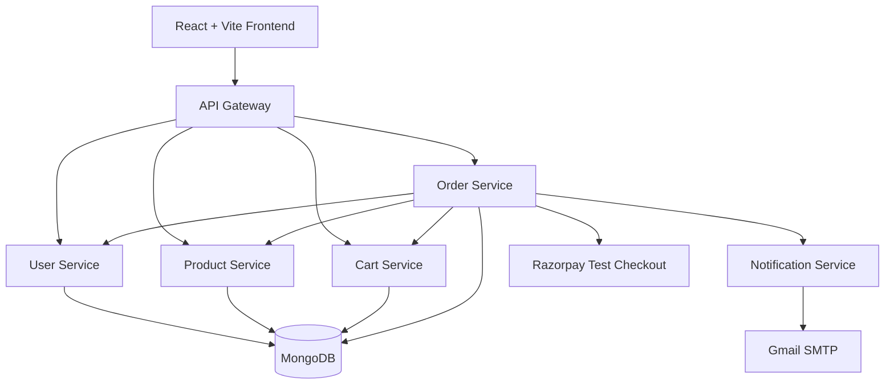

# NexaCart 🛒

**NexaCart** is a full-stack e-commerce application built with a React frontend and a Node.js/Express microservices backend. The system is organized into independent services for users, products, carts, orders, and notifications, with an API Gateway as the frontend's entry point.

> Project status: features have been implemented and tested locally by the developer(Pankaj). Razorpay is configured for **test mode**. Production deployment and production payment configuration are not implied.

## Highlights

- React + Vite frontend
- Node.js and Express backend services
- Microservices architecture with an API Gateway
- MongoDB persistence
- JWT-based user authentication
- Product catalog and cart
- Checkout and order management
- Cash on Delivery (COD) and Razorpay test checkout
- Order history, cancellation, and order tracking UI
- Profile management, password change, and account deletion
- Email notifications through Gmail SMTP
- Dockerfiles and Docker Compose configuration
- Swagger/OpenAPI documentation served through the API Gateway (`/api-docs`, if enabled by the current configuration)

## Tech Stack

| Area | Technologies |
|---|---|
| Frontend | React, Vite, JavaScript, CSS |
| Backend | Node.js, Express.js |
| Database | MongoDB Atlas, Mongoose |
| Authentication | JWT |
| Payments | Razorpay (test mode) |
| Email | Nodemailer / Gmail SMTP configuration |
| API documentation | Swagger / OpenAPI |
| Containers | Docker, Docker Compose |
| Source control | Git, GitHub |

## Architecture

The frontend communicates with the API Gateway. The gateway routes requests to the backend services. Services own their respective responsibilities and use MongoDB for persistence. Internal service calls are protected using service-authentication middleware/configuration where implemented.



See [Architecture](docs/ARCHITECTURE.md) for more detail.

## Services

| Component | Responsibility |
|---|---|
| API Gateway | Single entry point for frontend API requests; routes requests to services and hosts API documentation configuration |
| User Service | Registration, login, profile, password updates, account deletion, token/auth-related operations |
| Product Service | Product catalog and product-related operations |
| Cart Service | User cart operations |
| Order Service | Checkout/order lifecycle, payment integration, order history/cancellation/tracking data |
| Notification Service | Email notifications through configured SMTP credentials |

## Core User Flow

1. A user registers or logs in.
2. The frontend receives and stores an authentication token.
3. The user browses products and adds items to their cart.
4. The user proceeds to checkout and chooses an available payment option.
5. The Order Service processes order creation and coordinates relevant service operations.
6. The order confirmation notification is sent through the Notification Service, when email configuration is available.
7. The user can view orders and use supported order-management actions, such as cancellation and tracking UI.

## Getting Started

### Prerequisites

Install the following before running the project:

- Node.js and npm
- MongoDB connection (local instance or MongoDB Atlas)
- Git
- Docker Desktop (for container-based setup, if the Compose configuration is ready for your local environment)

### 1. Clone the repository

```bash
git clone https://github.com/pankaj-kumar16/NexaCart.git
cd NexaCart
```

### 2. Configure environment variables

Each backend service uses its own `.env` file. The repository intentionally excludes environment files to keep credentials out of version control.

Create `.env` files in the service folders based on each service's configuration. Use the source code to confirm the exact variable names before adding values.

Services with environment configuration:

- `api-gateway/`
- `user-service/`
- `product-service/`
- `cart-service/`
- `order-service/`
- `notification-service/`

**Never commit real secrets.** Do not put MongoDB credentials, JWT secrets, Razorpay secret keys, Gmail app passwords, or service keys into GitHub.

### 3. Install dependencies

Install dependencies in each service and the frontend folder:

```bash
cd api-gateway && npm install
cd ../user-service && npm install
cd ../product-service && npm install
cd ../cart-service && npm install
cd ../order-service && npm install
cd ../notification-service && npm install
cd ../frontend && npm install
```

Return to the project root after installing.

### 4. Run the application

The project includes Dockerfiles and a `docker-compose.yml`. Review the Compose file and required environment variables, then run from the project root if its configuration supports the current setup:

```bash
docker compose up --build
```

If you run services individually, use each service's package scripts and configured port. The local development ports used in this project are:

| Component | Port |
|---|---:|
| API Gateway | 5000 |
| User Service | 5001 |
| Product Service | 5002 |
| Cart Service | 5003 |
| Order Service | 5004 |
| Notification Service | 5005 |
| Frontend (Vite default) | 5173 |

Ports and scripts can be changed in configuration; verify your local files before starting services.

## API Documentation

Swagger/OpenAPI documentation is configured in the API Gateway. When the gateway is running, try:

- `http://localhost:5000/api-docs`

If the route differs in the current checkout, inspect the API Gateway Swagger setup.

For an overview, see [API Guide](docs/API.md).

## Project Documentation

- [Architecture](docs/ARCHITECTURE.md)
- [Database Design](docs/DATABASE.md)
- [API Guide](docs/API.md)
- [Deployment Guide](docs/DEPLOYMENT.md)
- [Security Notes](docs/SECURITY.md)
- [Project Overview](docs/PROJECT_OVERVIEW.md)

## Screenshots

Add screenshots to `docs/screenshots/` and link them here when captured. Suggested screenshots:

- Home/catalog page
- Product browsing
- Cart
- Checkout
- Order success
- My Orders / tracking
- Profile settings

Example once screenshots are added:

```md

```

## Roadmap / Potential Improvements

- Add automated tests for service APIs and end-to-end checkout
- Set up CI workflows for linting, tests, and frontend build
- Deploy frontend and services to a cloud environment
- Add centralized logs, metrics, and health monitoring
- Improve API rate limiting and production hardening
- Add documented environment templates containing placeholders only

## Security

- Keep `.env` files untracked.
- Use strong JWT and internal service secrets.
- Use HTTPS in deployed environments.
- Restrict CORS to trusted origins for production.
- Use payment provider production keys only after production configuration and verification.
- See [Security Notes](docs/SECURITY.md).

## License

No license has been selected yet. Until a license is added to the repository, reuse and redistribution permissions are not explicitly granted.
