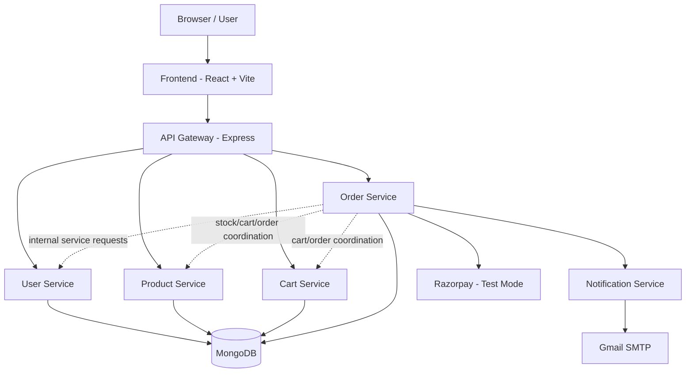

# NexaCart Architecture

## Overview

NexaCart is split into a React frontend, an API Gateway, and backend microservices. The Gateway is the frontend-facing entry point; backend services are separated by domain responsibility.

## System diagram

## Component responsibilities

### Frontend
- UI and navigation
- Authentication state and token handling
- Product browsing, cart, checkout, orders, tracking, profile screens
- Calls backend APIs through the Gateway

### API Gateway
- Central API entry point
- Routes requests to service endpoints
- Centralizes API-facing configuration and documentation

### User Service
- Registration and login
- Profile retrieval and update
- Password change
- Account deletion
- Internal user lookup for other services

### Product Service
- Product catalog endpoints
- Product data and inventory-related operations

### Cart Service
- Cart retrieval and mutation
- Cart persistence for users

### Order Service
- Order placement and lifecycle
- Checkout/payment workflow
- Order history and cancellation
- Coordinates required service calls and payment integration

### Notification Service
- Sends email notifications using configured SMTP provider

## Request flow: checkout

1. Frontend submits checkout through Gateway.
2. Gateway forwards request to the appropriate service.
3. Order Service validates the request and coordinates user/cart/product-related operations.
4. Payment is handled using the configured payment mode (COD or Razorpay test flow, where enabled).
5. Order data is persisted.
6. Notification Service is called for email confirmation when configured.

## Authentication and internal requests

- User authentication uses JWT.
- Protected endpoints use authentication middleware.
- Internal service calls use service-authentication mechanisms where configured.
- Secrets are supplied via environment variables, not committed to source control.

## Local development ports

| Service | Port |
|---|---:|
| Gateway | 5000 |
| User | 5001 |
| Product | 5002 |
| Cart | 5003 |
| Order | 5004 |
| Notification | 5005 |
| Vite frontend | 5173 (default) |

Verify port assignments in each service's configuration before deployment.
