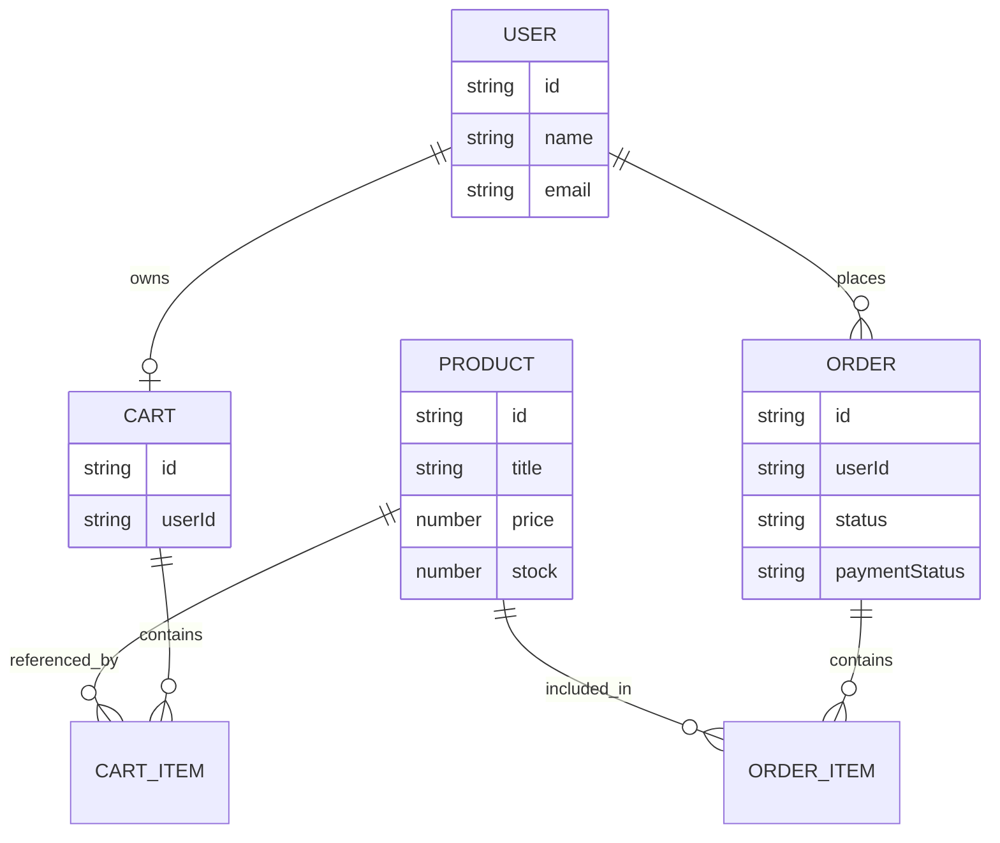

# NexaCart Database Design

NexaCart uses MongoDB with Mongoose models. The domain is separated into user, product, cart, and order data.

> This is a conceptual overview. Confirm field names, indexes, embedded documents, and references against the current Mongoose models before using it as a formal schema specification.

## Core entities

### User
Stores account information and authentication-related data. Profile operations include name/email updates; password operations are handled by the User Service. Passwords should be stored as hashes, never plaintext.

### Product
Represents catalog items and product information. Inventory/stock fields are used by the product/order flow.

### Cart
Represents a user's current cart and the items they intend to purchase.

### Order
Represents a submitted purchase, including order items, customer association, amounts, payment method/status, and lifecycle/tracking data as defined by the current model.

## Conceptual relationships

The diagram is logical rather than a literal MongoDB schema: MongoDB may store item arrays as embedded subdocuments rather than separate collections.
